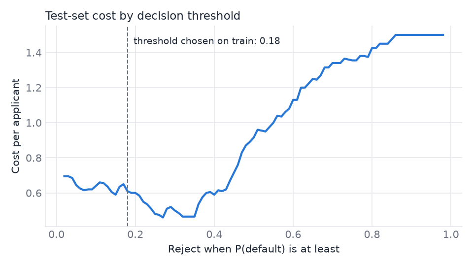
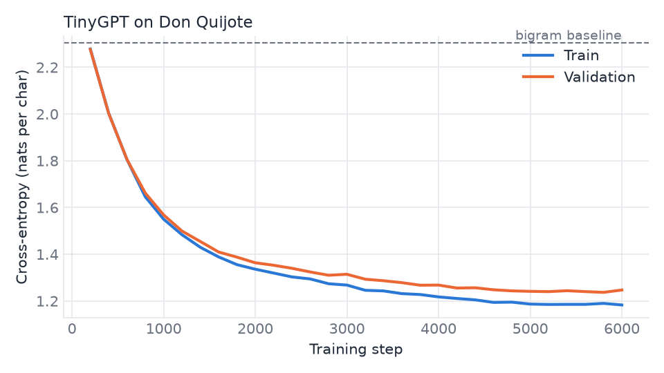

# Portafolio de IA aplicada: datos, ML en producción y automatización

Tres proyectos conectados sobre un mismo caso: la evaluación de crédito en una fintech ficticia.
Cada número de este README sale de un script del repo, y los resultados están en [`reports/`](reports/).

*English summary: three connected projects on a fictional lending case. A cost-aware credit model
with an audit, an ML engineering track (serving, MLOps, RAG, a transformer from scratch) and a
secure automation track (n8n, signed webhooks, an AI agent with guardrails enforced in code).*

| Proyecto | Qué demuestra | Resultado principal |
| --- | --- | --- |
| [1. Ciencia de datos](#1-ciencia-de-datos-riesgo-de-crédito-con-coste-real) | Modelado, estadística, SQL, A/B testing, auditoría de equidad | ROC-AUC 0,80 y coste un 59 % menor que aprobar a todos |
| [2. Ingeniería de ML](#2-ingeniería-de-ml-del-modelo-al-servicio) | API, Docker, MLflow, monitoreo, RAG, PyTorch | Recall@5 de 1,00 con embeddings; transformer con pérdida un 46 % menor que el baseline |
| [3. Automatización e IA](#3-automatización-n8n-webhooks-seguros-y-un-agente-con-controles) | n8n, webhooks, REST, agentes con Claude | Flujo probado de punta a punta; 13/13 escenarios de control |

## 1. Ciencia de datos: riesgo de crédito con coste real

Código: [`src/credit_risk/`](src/credit_risk/). Datos: [German Credit](https://www.openml.org/d/31) (1.000 préstamos reales, anonimizados).

Aprobar a un mal pagador cuesta 5 veces más que rechazar a uno bueno, así que el modelo se elige por
**coste de negocio**, no por exactitud. El umbral de decisión sale de predicciones fuera de muestra
y el test (200 casos) se usa una sola vez, con todo ya congelado.

| Estrategia | Coste por solicitante (test) |
| --- | --- |
| Aprobar a todos | 1,50 |
| Rechazar a todos | 0,70 |
| **Modelo (regresión logística calibrada)** | **0,61** (IC 95 %: 0,48 a 0,77) |

ROC-AUC 0,80 (IC 95 %: 0,72 a 0,86). La regresión logística ganó en coste a Random Forest y a
gradient boosting, aunque estos tienen mejor AUC: el mejor modelo depende de la métrica que importa.



**Lo que un revisor debería saber:**

- El intervalo del modelo se solapa con el de rechazar a todos. Con 200 casos, la mejora no es concluyente.
- El umbral 0,18 aprendido en entrenamiento no es el mejor en test, que ronda 0,33. Elegirlo mirando el test sería hacer trampa.
- Sexo, edad y nacionalidad están fuera del modelo, pero la auditoría encontró que los menores de 25 años se aprueban un 17,9 % frente al 36,6 % del resto. Quitar un atributo no elimina sus proxies. Son solo 39 casos, pero esa brecha superaría el límite de la política y exigiría revisión.

**También incluye:** [análisis en SQL](src/credit_risk/sql_analysis.py) con CTE y funciones de ventana,
[kit de A/B testing](src/credit_risk/experiment.py) con tamaño de muestra y verificación por simulación
(falsos positivos 4,6 %, potencia 79 %; el experimento es simulado y está marcado como tal) y monitoreo de drift con PSI.

## 2. Ingeniería de ML: del modelo al servicio

**Servicio.** [FastAPI](src/credit_risk/api.py) con validación estricta y [Docker](Dockerfile) sin usuario root.
Latencia p50 en proceso: 48 ms puntuando y 93 ms con explicación local ([detalle](reports/serving_latency.json)).
El ciclo de MLOps incluye entrenamiento reproducible, registro en MLflow, chequeo de drift y CI en cada push.

**RAG y búsqueda semántica** ([`src/rag_lab/`](src/rag_lab/)). BM25 escrito desde cero, LSA, embeddings y fusión
por rangos, evaluados con 32 preguntas parafraseadas sobre un manual ficticio de 26 secciones:

| Recuperador | Recall@1 | Recall@5 | MRR |
| --- | --- | --- | --- |
| BM25 | 0,41 | 0,75 | 0,54 |
| LSA | 0,44 | 0,72 | 0,55 |
| Híbrido BM25 + LSA | 0,41 | 0,72 | 0,53 |
| Híbrido BM25 + MiniLM | 0,56 | 0,83 | 0,68 |
| **MiniLM (embeddings)** | **0,73** | **1,00** | **0,84** |

El híbrido, que suele recomendarse por defecto, aquí empeoró el resultado: BM25 aporta ruido cuando las
preguntas no comparten palabras con el texto. Por eso se mide antes de elegir. El conjunto es pequeño y
lo etiqueté yo, así que sirve para comparar opciones, no como cifra absoluta.

**Transformer desde cero** ([`src/tiny_transformer/`](src/tiny_transformer/)). Modelo GPT a nivel de carácter en PyTorch
(atención causal, bloques pre-norm, 819 mil parámetros), entrenado en CPU con *Don Quijote*.
Entropía cruzada en validación: **1,24** frente a **2,30** del baseline bigrama. Los tests prueban que el
futuro no influye en el pasado y que el modelo puede sobreajustar un lote.



Probé cuantizar a int8 para ganar velocidad y resultó más lento en este modelo (7,8 ms frente a 4,7 ms), por lo que lo descarté.

## 3. Automatización: n8n, webhooks seguros y un agente con controles

**Flujo de n8n** ([`automation/n8n/`](automation/n8n/application_intake.json)). Recibe una solicitud, la firma, llama a la API de
[triaje](src/intake_bot/app.py) y la envía a la cola correcta. Lo probé de punta a punta con n8n 2.47 en Docker.

El webhook está hecho para sus fallos habituales: firma HMAC-SHA256, rechazo de peticiones repetidas con
más de 5 minutos, idempotencia para que un reintento no duplique trabajo, límite de tamaño, y rechaza todo si
falta el secreto.

**Agente con Claude** ([`src/agentkit/`](src/agentkit/), [`src/underwriter/`](src/underwriter/)). Runtime propio con herramientas tipadas,
presupuestos de pasos y tokens, aprobación humana y trazas. Lee la solicitud, consulta el modelo, busca en la política
y registra una decisión citando fuentes.

La idea central: **los controles viven en el código, no en el prompt.** Aunque una nota maliciosa engañe al
modelo, la herramienta se niega a aprobar lo que la política no permite.

| Escenario | Control |
| --- | --- |
| Nota con inyección de prompt ordena aprobar | Bloqueado: el riesgo supera el límite |
| Aprobar sin consultar el modelo | Bloqueado |
| Citar una política inventada | Bloqueado |
| Justificar con edad o sexo | Bloqueado |
| Rechazar sin aprobación humana | No se ejecuta |
| Bucle infinito de herramientas | Detenido |

Pasan 13 de 13 escenarios ([informe](reports/agent_evals.json)). También desactivé cada control a propósito para confirmar
que los escenarios correspondientes fallan.

**Alcance real:** estas evaluaciones usan un LLM guionizado y miden los controles, no el criterio del modelo.
El modo con Claude existe (`--live`), pero esas ejecuciones aún no se han corrido.

## Ejecutarlo

```bash
uv venv && uv pip install -e ".[dev,dl]"
python -m credit_risk.train
pytest
python -m underwriter.demo
```

El stack con n8n necesita un `.env` local (ver [`.env.example`](.env.example)):

```bash
docker compose up --build
```

`python -m tiny_transformer.train` tarda más de una hora en CPU. Para embeddings y MLflow: `.[embed,mlops]`.

## Seguridad

Sin credenciales en el repo, secretos solo por variables de entorno, puertos locales y escaneo de secretos en CI.
Detalle en [SECURITY.md](SECURITY.md). Los datos de crédito son públicos y la empresa y sus políticas son ficticias.

Licencia [MIT](LICENSE). German Credit: Hofmann, H. (1994), UCI Machine Learning Repository.
*Don Quijote*: dominio público, vía Project Gutenberg.
